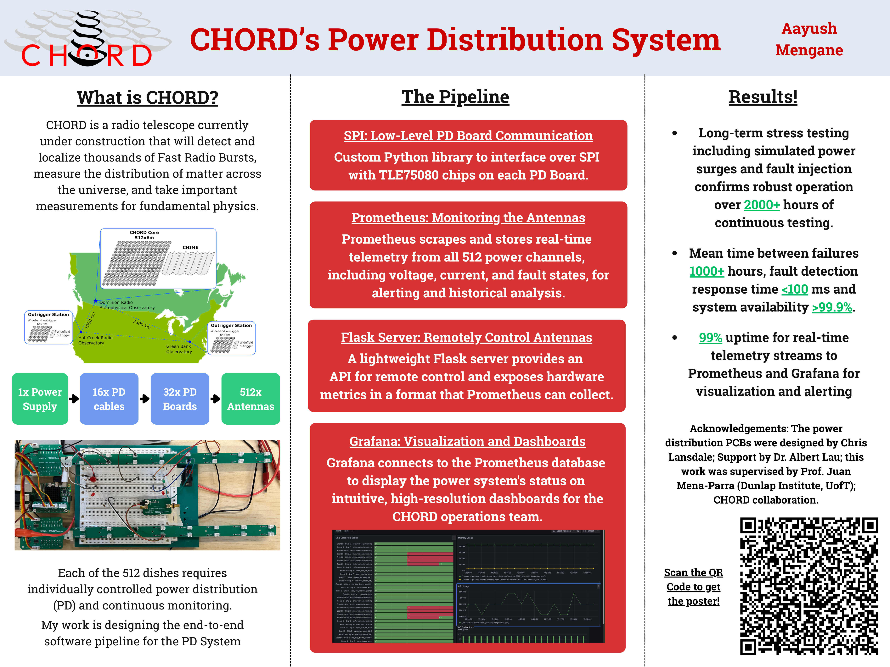

# CHORD Power Distribution System

Control and monitoring software for the power distribution (PD) system of
**CHORD**, the Canadian Hydrogen Observatory and Radio-transient Detector, a radio telescope
under construction that will detect and localize thousands of Fast Radio Bursts,
map the distribution of matter across the universe, and make measurements for
fundamental physics.

Each of CHORD's 512 dishes needs individually controlled power and continuous
health monitoring. This repo is the end-to-end software pipeline for that: it
goes from raw SPI frames on the PD boards to a REST API and live Grafana
dashboards for the operations team.



## Hardware

```
1x Power Supply ──► 16x PD cables ──► 32x PD Boards ──► 512x Antennas
```

Each PD board has two **Infineon TLE75080** 8-channel smart low-side switches
(chips **A** and **B**), giving 16 switched channels per board. The chips on all
boards are daisy-chained on a single SPI bus, so every transaction shifts one
16-bit frame through every chip in the chain.

## Pipeline

| Layer | File | What it does |
|---|---|---|
| **SPI driver** | `spi_ops.py` | Custom Python library for the TLE75080 over `spidev`. Builds daisy-chain frames for any board/chip, supports per-chip and broadcast commands, and runs batches on a single worker thread behind a lock so concurrent API calls never interleave on the bus. |
| **Control API** | `flask_server.py` | Lightweight Flask server exposing hardware control and diagnostics as HTTP endpoints. |
| **CLI** | `send_commands.py` | Command-line client for the Flask API. |
| **Telemetry** | `prometheus_server.py` | Polls the standard-diagnostic frame from every chip, decodes all 16 fault bits (under-voltage, open-load, per-channel overload/over-temperature, …) and exports them as Prometheus gauges on `/metrics`. |
| **Dashboards** | Grafana | Grafana reads the Prometheus database and shows per-board, per-chip fault status in real time, with alerting. |
| **Entry point** | `launch.py` | Opens SPI, starts the exporter and polling thread, then serves the API. |

Supported chip registers (`spi_ops.operations`):

| Operation | Read | Write | Purpose |
|---|:-:|:-:|---|
| `OUT` | ✓ | ✓ | Channel output on/off states |
| `DIAG_OLON` | ✓ |  | Open-load-in-ON-state check results |
| `DIAG_OLONEN` | ✓ | ✓ | Select channel for open-load check |
| `HWCR_OCL` | ✓ | ✓ | Output control latch / clear fault latches |
| `STD_DIAG` | ✓ |  | Standard diagnostic frame |

## Getting started

Runs on a Raspberry Pi (or any Linux host with SPI enabled).

```bash
python3 -m venv .venv && source .venv/bin/activate
pip install -r requirements.txt

# Optional: confirm the SPI device can be opened
python spi_check.py

# Start SPI + Prometheus exporter + Flask API
python launch.py
```

Then point Prometheus at the exporter (see `prometheus.yml.example`) and add it
as a data source in Grafana:

```bash
./prometheus --config.file=prometheus.yml
sudo systemctl start grafana-server
```

Settings like SPI bus/device/speed, number of boards, ports and poll interval
are in `config.py`.

## API

| Method | Endpoint | Body | Description |
|---|---|---|---|
| `POST` | `/write_command[?verify=true]` | `{"board_idx", "chip_letter", "operation", "states"}` | Write an 8-bit register (e.g. channel states). With `verify`, reads every chip back afterwards. |
| `POST` | `/read_command` | `{"board_idx", "chip_letter", "operation"}` | Read a register from one chip. |
| `GET`  | `/std_diag` | | Standard diagnostic frame from every chip. |

### CLI examples

```bash
# Turn on channels 0-3 of board 0, chip A, and verify
python send_commands.py write_command 0 a OUT 00001111 --verify

# Read the output register of board 1, chip B
python send_commands.py read_command 1 b OUT

# Standard diagnostics for all chips
python send_commands.py std_diag
```

## Metrics

`chip_diagnostic_flag{board, chip, flag_position, flag_name}`: `1` when the
flag is set. Flags include `vs_undervoltage`, `open_load_off_state`,
`ch0_overload_overtemp` … `ch7_overload_overtemp`, and more (see
`FLAG_NAMES` in `prometheus_server.py`).

## Results

- Long-term stress testing with simulated power surges and fault injection, over **2000+ hours** of continuous operation
- Mean time between failures **1000+ hours**, fault detection response time **< 100 ms**, system availability **> 99.9%**
- **99%** uptime for real-time telemetry streams to Prometheus and Grafana

## Acknowledgements

The power distribution PCBs were designed by Chris Lansdale, with support from
Dr. Albert Lau. This work was supervised by Prof. Juan Mena-Parra (Dunlap
Institute, University of Toronto) as part of the CHORD collaboration.

**Author:** Aayush Mengane
